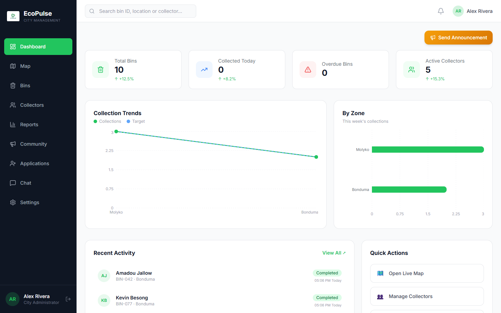
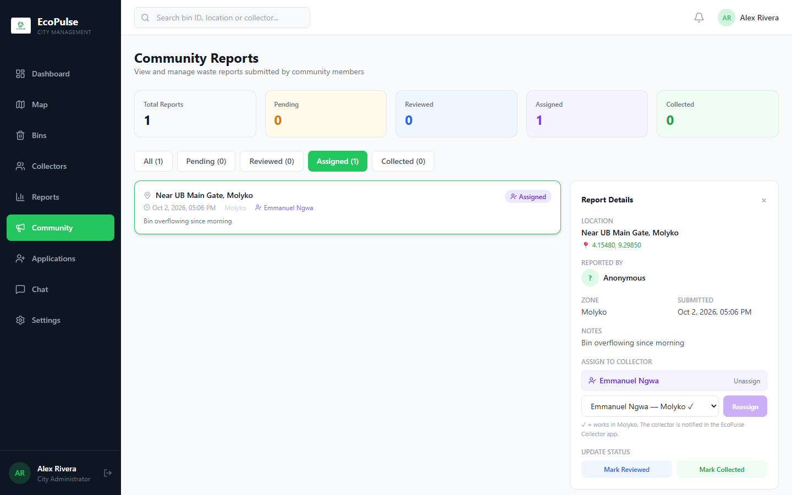
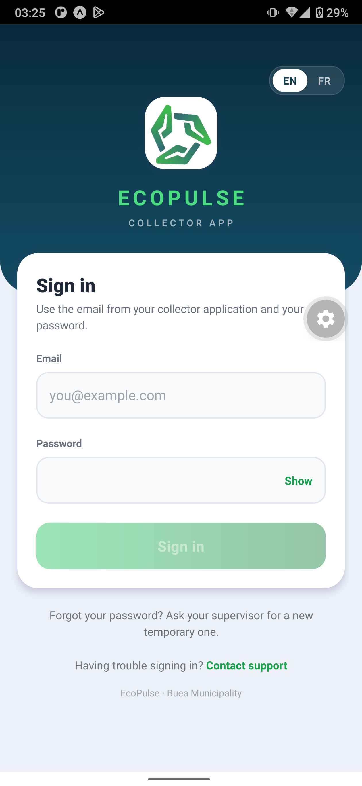
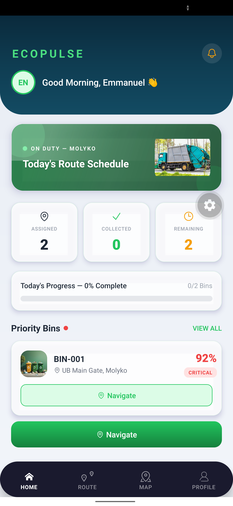
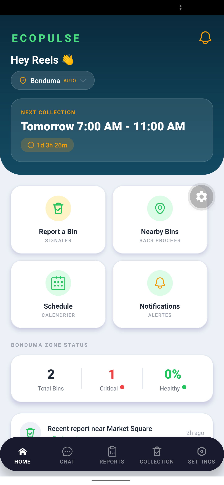

# EcoPulse: Building a Cleaner Buea, One Connected Report at a Time

*By Suh Blane Sanyang, Level 300 Software Engineering Student at the University of Buea | 2026 Millennium Fellow*

---

When the rains come to Molyko, they do not come alone. They carry with them whatever the week's waste collection missed — and in a fast-growing university town at the foot of Mount Cameroon, that is a lot. Blocked drains turn roads into streams, overflowing bins become breeding grounds near markets and student hostels, and the people most affected have no simple way to say, *"this bin has been full for three days."*

**EcoPulse** is my answer to that silence: a smart waste-management ecosystem that connects the three groups who keep a city clean — municipal staff, waste collectors, and residents — into one shared, real-time system. This article is written for Team MCN, my fellow Millennium Fellows, and everyone building technology for good.

---

## Part 1 — The Problem, and Why It Matters

Buea Municipality manages waste across four zones — Molyko, Great Soppo, Bonduma, and Buea Town — largely on paper and over phone calls. Collectors follow fixed rounds whether or not bins are full. Residents who spot an overflowing bin have no formal channel to report it, and no way to know if anyone acted. There is no reliable record of what was collected, where, or by whom. The result is predictable: waste that sits long enough to choke drains and, when the rains arrive, worsen the flooding Molyko already knows too well.

EcoPulse is deliberately aligned with two Sustainable Development Goals and a core academic commitment:

- **SDG 11 — Sustainable Cities and Communities:** making waste collection responsive, data-driven, and accountable.
- **SDG 9 — Industry, Innovation and Infrastructure:** building resilient digital infrastructure that works with the tools people already own.
- **UNAI Principle 9 — a commitment to promoting sustainability:** turning environmental care into something every resident can participate in from their phone.

My target for the Fellowship is simple and measurable: give every resident in these four zones a free, two-tap way to report a problem, and give the municipality the live visibility to respond — no expensive sensors, no new hardware, just software and smartphones.

---

## Part 2 — The Architecture and the Build

EcoPulse is a full-stack system: one backend and three purpose-built clients.

**The backend** is a REST API built with **Node.js and Express**, backed by **MongoDB**. It is the single source of truth — accounts and roles, bins, reports, assignments, schedules, chat, and notifications all flow through it. Authentication uses JSON Web Tokens, passwords are hashed with bcrypt, and every endpoint checks the caller's role so a collector can never reach an administrator's tools.

**The Admin Dashboard** is a **React 19 + Vite** web application for municipal staff. It opens onto a live operational picture: bins by status, collection trends, zone-by-zone activity, and quick actions.

*The administrator's command centre: total bins, collections today, overdue bins, and active collectors across Buea, with collection trends and a zone-by-zone breakdown. This is where a paper-and-phone operation becomes a dashboard.*

The heart of the system is **report assignment**. When a resident reports a bin, it lands here with its photo, GPS coordinates, and note. The administrator assigns it to a collector — and crucially, collectors who already work in that report's zone are suggested first, so help comes from nearby.

*A real report — "Bin overflowing since morning," near UB Main Gate, Molyko — being assigned to Emmanuel Ngwa, a collector who works in Molyko. The moment this is assigned, he is notified in the Collector App.*

**The Collector App** is an **Expo (React Native)** app for Android. Collectors sign in, see the day's route and their assigned reports, and navigate to each site.

*The Collector App sign-in — bilingual English/French from the first screen, with a clear "Contact support" path for field workers who hit a problem.*

*"Good Morning, Emmanuel" — on duty in Molyko, with today's route, a live progress bar, and priority bins ranked by urgency. BIN-001 at UB Main Gate is flagged critical at 92% full.*

What makes a collection *trustworthy* is **GPS-verified proof**. When a collector finishes, they photograph the cleaned spot, and the app records the phone's location. The server then computes the **Haversine great-circle distance** between that location and the reported bin — mathematically confirming the collector was actually *there* — before an administrator approves the photo and closes the report. Accountability, verified by geometry.

**The Community App**, also built with **Expo**, is where it all begins — the residents' voice.

*The resident's home screen auto-detects the zone (Bonduma), shows the next collection window with a countdown, and puts "Report a Bin" one tap away — alongside nearby bins, schedules, and notifications, in English and French.*

---

## Part 3 — Leadership Reflections: Designing for Everyone

The Millennium Fellowship pushed me to lead with empathy, not just engineering — and that changed the product.

My sharpest lesson came from asking *who gets left out*. In Buea's markets, many of the people closest to the waste problem are older traders who do not use email and may have limited experience with apps. An ordinary "sign up with your email" wall would have silenced exactly the voices I most needed to hear. So the Community App asks residents for **nothing but a name and a phone number**; their identity is tied securely to their device, with no password to forget. Inclusion became an architectural decision, not an afterthought.

**Low-data optimization** was the same principle applied to money. Mobile data is a real cost here, so photos are compressed on the phone before upload, and all mapping uses **OpenStreetMap** — no paid map keys, no licence fees. The whole platform runs without a single sensor or recurring hardware bill.

For collectors, I balanced security with usability: they sign in with an email and password, and an administrator can issue a temporary password that the collector replaces on first sign-in — so no one is ever locked out of their livelihood by a forgotten credential.

I executed against **SMART milestones** throughout — shipping the backend, then each client, then verified assignment and proof-of-collection — testing on a real Android phone and keeping the whole system covered by automated tests that run on every change.

---

## Part 4 — Advice for Fellow Change-Makers

- **Design for proximity.** The best help is local help. Suggesting same-zone collectors first was a small feature with an outsized human impact — it is the difference between a response in minutes and one that never comes.
- **Treat data gaps as design problems, not dead ends.** I could not afford bin sensors, so I turned residents and collectors into the sensing network. Constraints, met honestly, often produce more inclusive solutions than money would have.
- **Lean on open-source and open-data.** OpenStreetMap, Node.js, React, and Expo let a single student build a city-scale system for the price of time. The tools for good are already free — what they need is someone willing to point them at a local problem.
- **Build for the person you can't see.** The elderly trader, the collector in the rain, the resident on a 2G connection — if your technology works for them, it works for everyone.

EcoPulse is not just code. It is a small, stubborn argument that a cleaner, more accountable Buea is buildable — by us, from here, now.

*Follow the build and read the technical documentation on the EcoPulse repository.*
